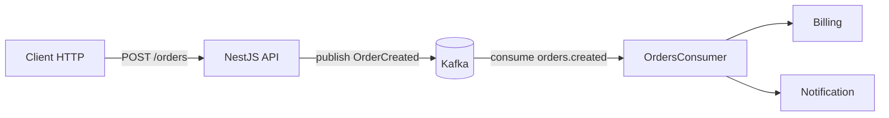
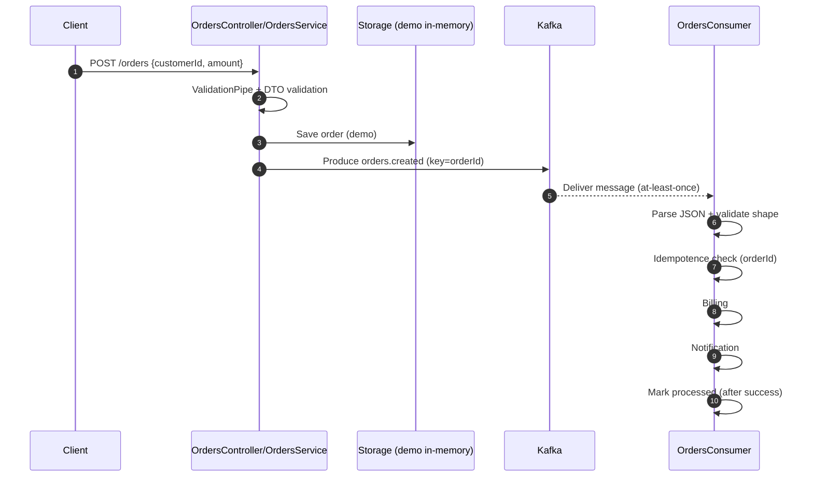

# Architecture (Kafka) — NestJS Orders (Event-Driven)

Ce document décrit **le workflow Kafka** de ce projet, la **communication par events**, et les **bonnes pratiques** à appliquer pour passer d’une démo à une implémentation production.

## 1) Vue d’ensemble

### Composants
- **API HTTP (NestJS)**
  - Endpoint: `POST /orders`
  - Rôle: valider la requête, sauvegarder la commande, publier un event Kafka.
- **Kafka**
  - Topic principal: `orders.created`
  - Sémantique: **at-least-once** (un message peut être livré 1+ fois).
- **Consumer NestJS**
  - Rôle: consommer `orders.created` et exécuter des side-effects (facturation, notification).

### Diagramme (haut niveau)


## 2) Contrat d’event (event contract)

### Topic
- **Nom**: `orders.created`
- **Type d’event**: `OrderCreated`
- **Key Kafka**: `orderId` (important pour l’ordre par commande et la partition)

### Payload (JSON)
Dans ce projet, l’event est un objet JSON (pas une instance de classe).

Exemple:
```json
{
  "eventId": "0b2d...",
  "orderId": "a8c1...",
  "customerId": "cust_123",
  "amount": 42,
  "createdAt": "2026-02-03T12:34:56.000Z"
}
```

### Règles de compatibilité
- **Ne jamais casser** les consommateurs existants: préférer ajouter des champs optionnels.
- Versionner si nécessaire (ex: champ `schemaVersion` ou topic versionné `orders.created.v2`).

## 3) Workflow détaillé

### Séquence


### Code mapping (où ça se passe)
- Producer: `OrdersService.createOrder()`
- Consumer: `OrdersConsumer.onModuleInit()` + `handleOrderCreated()`
- Kafka client: `KafkaService` (producer + consumer)

## 4) Sémantique Kafka: at-least-once et idempotence

### Pourquoi il faut l’idempotence
Kafka (et la plupart des consumers) fournissent en pratique une livraison **at-least-once**:
- si ton consumer crash après avoir fait la facturation mais avant d’avoir commit/ack, le message peut être rejoué
- si une erreur transient se produit, tu peux retraiter le même event

➡️ Donc **le traitement doit être idempotent**: exécuter 2 fois ne doit pas doubler les effets (double facturation, double email...).

### Idempotence dans ce projet
- Démo: stockage mémoire avec TTL (`Map<orderId, processedAt>`)
- Règle importante: **marquer “processed” après le succès** des side-effects

### Idempotence production (recommandé)
Choisir une stratégie durable:
- **Inbox table** (DB) avec contrainte unique sur `eventId` (ou `orderId` selon le cas)
- ou **Redis** (set NX + TTL)
- ou contrainte unique sur le “business side-effect” (ex: table `invoices` unique par `orderId`)

## 5) Clés, partitions, ordering

### Key = `orderId`
Bonnes raisons:
- garantit l’ordre **par commande** (tous les events d’une même commande iront sur la même partition)
- facilite l’idempotence / corrélation

### Règles pratiques
- Key stable et pertinente métier (souvent `orderId` ou `customerId` selon la logique)
- éviter les keys aléatoires (perte de locality)

## 6) Gestion des erreurs, retries, DLQ

### Dans ce projet
- Si `handleOrderCreated()` jette une erreur, on garde la logique at-least-once (Kafka rejouera selon la lib/config)

### Bonnes pratiques production
- **Retry** avec backoff (ex: 3 tentatives rapides + 1 longue)
- **DLQ** (Dead Letter Queue): topic `orders.created.dlq`
  - on y met les messages “poison” (payload invalide, données manquantes) après N tentatives
- **Observabilité**:
  - logs structurés (eventId/orderId)
  - metrics (lag, throughput, error rate)
  - tracing distribué (OpenTelemetry)

## 7) Transaction DB + publish Kafka (Outbox pattern)

Le piège classique:
1) on écrit en DB ✅
2) on publie l’event ❌ (down Kafka / timeout)

Résultat: la commande existe mais **aucun consumer n’est notifié**.

### Solution: Outbox
- même transaction DB: écrire `orders` + `outbox_events`
- un worker/publisher lit l’outbox et publie vers Kafka
- quand publish OK → marquer l’outbox comme `sent`

C’est la meilleure pratique quand tu veux garantir la cohérence “DB + event”.

## 8) Lifecycle & shutdown

### Pourquoi c’est important
En container (Docker/K8s), le process reçoit SIGTERM.
- il faut arrêter proprement: disconnect consumer/producer
- éviter les messages “en vol” perdus

### Dans ce projet
- `app.enableShutdownHooks()` permet d’appeler `onModuleDestroy()`
- `KafkaService` gère connect/disconnect

## 9) Configuration (env vars)

- `KAFKA_BROKERS` (ex: `kafka:9092` ou `localhost:29092`)
- `KAFKA_CONSUMER_GROUP_ID` (ex: `orders-group`)
- `ORDERS_CREATED_TOPIC` (ex: `orders.created`)
- `IDEMPOTENCE_RETENTION_MS`

## 10) Checklist bonnes pratiques (résumé)

- **Contrat d’event** stable, versionné si besoin
- **Key** cohérente (souvent `orderId`) pour ordering par entité
- **Idempotence** durable (DB/Redis) + “mark after success”
- **Outbox** pour fiabiliser DB + publish
- **Retry + DLQ** pour messages poison
- **Observabilité** (logs corrélés eventId/orderId, metrics lag)
- **Shutdown propre** (disconnect Kafka)

---

## Annex: commandes utiles (Docker)

Démarrer:
```bash
docker compose up --build
```

Voir les logs:
```bash
docker compose logs -f api
```

Consommer un topic depuis le container Kafka (si les scripts sont présents):
```bash
docker compose exec kafka bash
# puis kafka-console-consumer ... (selon l'image)
```
